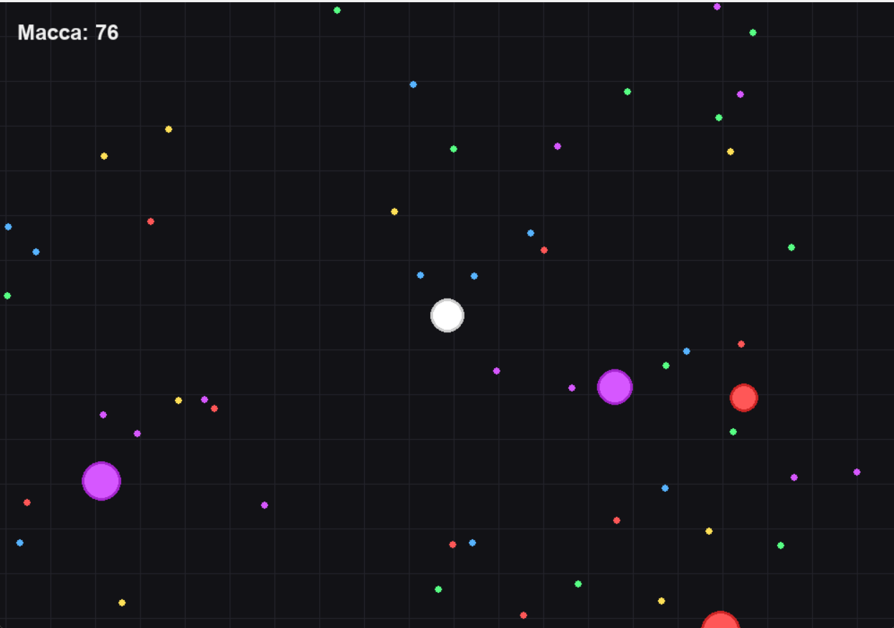
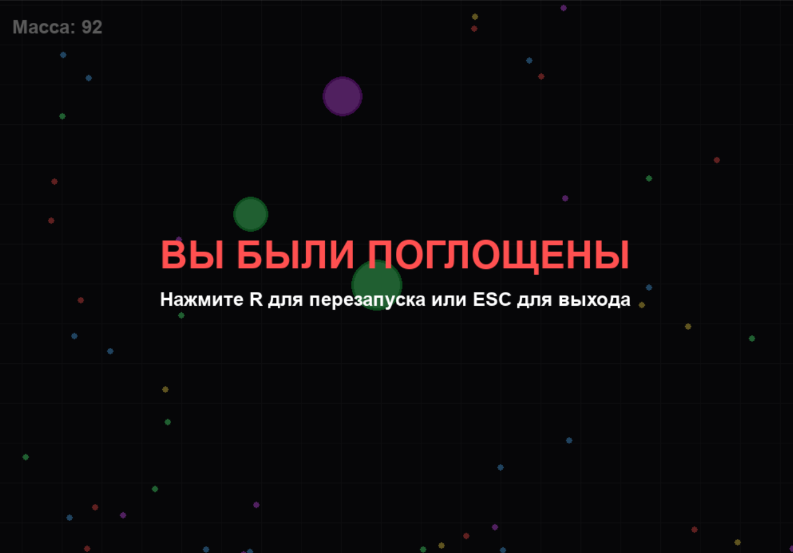

# Игра Agar.io
**Автор:** Власова Радмила Игоревна  
**Группа:** ПИ25-1  
**Дисциплина:** Практикум по программированию  
**Дата сдачи:** 25.11.2026

## Описание проекта
Двумерная аркадная игра по мотивам классической игры Agar.io. Игрок управляет клеткой с помощью курсора мыши, поглощает питательные частицы и более мелких ботов для набора массы и избегает крупных соперников. По мере увеличения массы скорость передвижения клетки плавно снижается.

## Функциональные возможности
### Основной функционал
- Плавное управление клеткой за курсором мыши с нормализацией вектора движения
- Физически корректный рост радиуса клетки пропорционально площади
- Зависимость скорости передвижения от текущей массы объекта
- Автономные боты-соперники со случайной навигацией по карте
- Динамическая камера с центрированием на игроке и фоновой координатной сеткой

### Дополнительный функционал
- Отображение текущей массы игрока в реальном времени
- Мгновенный перезапуск игровой сессии по нажатию клавиши `R`

## Демонстрация работы программы
### Игровой процесс


### Экран окончания игры



## Требования к системе
- **Python:** 3.9 или выше
- **Операционная система:** Windows / macOS / Linux
- **Библиотеки:** `pygame` (точная версия зафиксирована в `requirements.txt`)

## Установка и запуск

### 1. Клонирование репозитория
```bash
git clone https://github.com/radmilavlasova/agar-io-game
cd agar-io-game
```

### 2. Активация виртуального окружения
**Windows (CMD / PowerShell):**
```bash
venv\Scripts\activate
```

**Windows (Git Bash) / macOS / Linux:**
```bash
source venv/Scripts/activate
```

### 3. Установка зависимостей
```bash
python -m pip install -r requirements.txt
```

### 4. Запуск программы
```bash
python main.py
```

### 5. Управление в игре
- **Курсор мыши** — направление движения клетки
- **R** — перезапуск игры после поражения
- **ESC** — выход из приложения

## Структура проекта
```text
agar-io-game/
├── .gitignore
├── README.md
├── requirements.txt
├── main.py
├── screenshots/
│   └── gameplay.png
├── venv/
└── src/
    ├── __init__.py
    ├── app.py
    ├── models/
    │   ├── __init__.py
    │   ├── cell.py
    │   └── world.py
    └── renderers/
        ├── __init__.py
        └── renderer.py
```

**Обоснование архитектуры и назначение модулей:**
Проект разделен на слой данных/физики (`models`) и слой представления (`renderers`) по паттерну MVC, что позволяет изменять графику независимо от игровой математики.
- `main.py` — точка входа в программу.
- `src/app.py` — управление окном, обработка событий ввода и главный игровой цикл.
- `src/models/cell.py` — класс `Cell` с расчетом радиуса, скорости, вектора движения и проверкой поглощения.
- `src/models/world.py` — класс `World`, отвечающий за генерацию корма, поведение ботов и обработку столкновений.
- `src/renderers/renderer.py` — класс `Renderer`, реализующий отрисовку сетки, смещение камеры, рендер клеток и интерфейса.
